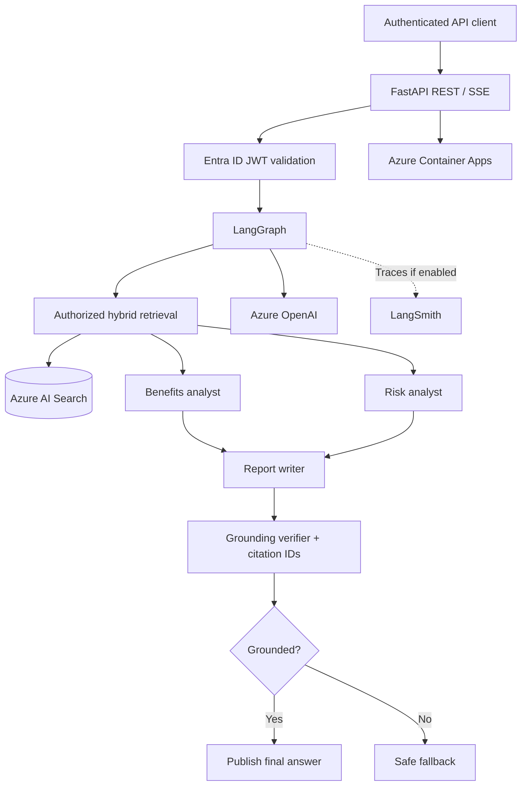

# Enterprise Multi-Agent RAG API

[](#testing) [](https://www.python.org/) [](https://docs.langchain.com/oss/python/langgraph/overview) [](https://azure.microsoft.com/)

A portfolio-ready **enterprise multi-agent Retrieval-Augmented Generation (RAG)** backend, built with LangGraph, Azure OpenAI, Azure AI Search, FastAPI, Docker, Microsoft Entra ID, LangSmith, and Azure Container Apps.

> **Status:** Working local demo with automated tests; Azure deployment requires your own configured Azure resources and validation. This is a reference implementation, not a certified production system.

## Architecture



**Execution:** Retrieval → parallel specialist agents → synthesis → verification → publication. The client sees safe progress events and the final answer, never the unverified draft.

## Features

- **LangGraph** fan-out/fan-in workflow and explicit verification gate.
- **Azure OpenAI** model and embeddings with Azure AD tokens via `DefaultAzureCredential`.
- **Azure AI Search** hybrid vector + keyword retrieval with semantic ranking and mandatory `owner_id` filter.
- **FastAPI** async JSON endpoint and POST-based Server-Sent Events (SSE) endpoint.
- **Microsoft Entra ID** delegated bearer-token verification in Azure mode.
- **Docker** non-root container, Azure Container Apps deployment scripts, and GitHub Actions CI/CD skeleton.
- **LangSmith** optional tracing via standard environment variables (enable only after privacy review).
- **Demo mode** runs without cloud resources; tests use deterministic fake agents.

## Quick start (no Azure required)

Requirements: Python 3.12+.

```bash
python -m venv .venv
# Windows: .venv\Scripts\activate
# Linux/macOS: source .venv/bin/activate
pip install -r requirements.txt
cp .env.example .env  # Windows PowerShell: Copy-Item .env.example .env
uvicorn app.main:app --reload
```

Default configuration: `APP_ENV=development`, `APP_MODE=demo`, `AUTH_MODE=demo`. **Never expose demo auth publicly.** Setting `APP_ENV=production` refuses demo authentication, although you must still configure network protections.

Open http://localhost:8000/docs or call:

```bash
curl -X POST http://localhost:8000/v1/research -H 'Content-Type: application/json' -d '{"question":"What are our AI governance requirements?"}'
```

Stream progress and the approved answer:

```bash
curl -N -X POST http://localhost:8000/v1/research/stream -H 'Content-Type: application/json' -d '{"question":"What is the MFA policy?"}'
```

The stream uses **POST**, so native browser `EventSource` cannot connect directly; use `fetch` streaming or implement an authenticated GET stream. The output is verified text emitted in chunks, not raw live LLM tokens.

## Azure mode

1. Provision Azure OpenAI with chat and embedding deployments, Azure AI Search, Container Registry, and Container Apps.
2. Create a search index with `id`, `title`, `source`, `content`, `owner_id` (filterable string), and `content_vector` (vector field matching embedding dimensions), plus semantic configuration `semantic-config`. **Populate with documents using trusted owner IDs.**
3. Register a **single-tenant** Microsoft Entra API, expose delegated scope `Research.Read`, and configure your client to request an access token for that API.
4. Set `APP_MODE=azure`, `AUTH_MODE=entra`, and all required values in `.env` (see `.env.example`).
5. Authenticate locally with `az login` or deploy with a managed identity. Assign `Cognitive Services OpenAI User` on the model resource and `Search Index Data Reader` on the search service; the image-pull identity also needs `AcrPull` on ACR.
6. Run `uvicorn app.main:app` and send an Entra-issued bearer token to `/v1/research`.

**Index contract:** This repository intentionally does not auto-create an index or ingest confidential documents. Schema, embeddings, index version, owner-ID mapping, and semantic ranker must be provisioned consistently. Ensure embedding dimensions match `content_vector`. Azure API versions and model deployment support vary by resource.

## REST API

| Method | Endpoint | Description |
|---|---|---|
| GET | `/health/live` | Process liveness |
| GET | `/health/ready` | Graph initialization readiness (not a dependency probe) |
| POST | `/v1/research` | Authenticated JSON research response |
| POST | `/v1/research/stream` | Authenticated SSE progress + final result |

Request:

```json
{"question": "What are our AI governance requirements?"}
```

JSON response includes `run_id`, `answer`, `verified`, and `sources` (sources are withheld on fallback).

## Testing

```bash
pytest -q
```

Tests cover successful execution, no-evidence routing, parallel specialists, verifier rejection, input validation, and SSE event filtering. They use demo adapters and make no paid Azure calls.

**Next tests before production:** Entra invalid/wrong-audience token cases, owner isolation with seeded Azure documents, injection attempts, model timeout/retry, integration tests with real Azure services, retrieval quality, grounding benchmark, load tests, and SSE disconnection/cancellation.

Run the small offline retrieval smoke benchmark with `python -m scripts.evaluate_retrieval` (the benchmark is illustrative, not a quality claim about real Azure retrieval).

## Docker

```bash
docker build -t enterprise-rag:local .
docker run --rm -p 8000:8000 --env APP_MODE=demo --env AUTH_MODE=demo enterprise-rag:local
```

## Deploy to Azure Container Apps

Provision a Container Apps environment, Container App, ACR, and user-assigned managed identity. Set Azure mode and Entra environment variables on the app, assign managed identity to the app, grant ACR pull and Azure service RBAC roles, and configure HTTPS ingress on port 8000.

```powershell
./infra/deploy.ps1 -ResourceGroup rg-enterprise-rag -AcrName YOUR_ACR -ContainerApp YOUR_APP -Tag v1
```

The GitHub Actions `deploy.yml` workflow is manual (`workflow_dispatch`) and uses **OIDC federation** via `azure/login`. Configure protected `production` environment and GitHub variables `AZURE_CLIENT_ID`, `AZURE_TENANT_ID`, `AZURE_SUBSCRIPTION_ID`, `AZURE_RESOURCE_GROUP`, `AZURE_ACR_NAME`, and `AZURE_CONTAINER_APP`. CI and deployment are deliberately separate; add staging, signed images, vulnerability scans, evaluation gates, approvals, and rollback before automated production releases.

## LangSmith tracing and observability

Set `LANGSMITH_TRACING=true`, `LANGSMITH_API_KEY`, and `LANGSMITH_PROJECT` to enable traces after confirming data handling, residency, and retention requirements. Trace payloads can contain prompts and retrieved content. API errors log an exception type and run ID rather than raw document content. Add OpenTelemetry / Azure Monitor instrumentation, request correlation, p95 latency, token usage, quotas, and alerts for real production monitoring.

## Security and limitations

- **Never deploy `AUTH_MODE=demo` on a public service.** Azure mode refuses to start unless Entra auth is configured.
- The Entra example requires a delegated user token with `Research.Read`, validates signature, issuer, audience, expiry, and tenant. It is **single-tenant**; do not assume app-only or multi-tenant support.
- `owner_id` filtering is a simple authorization demonstration. Enterprise ACL/group authorization, permission revocation, and index ingestion security need a dedicated design.
- A model-based grounding verdict plus citation-ID checks **does not guarantee factual correctness**. Evaluate against human-reviewed data and use stronger citation-to-claim checks.
- SSE sends only progress and post-verification text. HTTP response headers are committed before streaming; failures are delivered as `error` events.
- A request timeout is included, but global rate limiting, backpressure, persistent LangGraph checkpointing, external durable queues, request auditing, and network isolation remain future work.
- The project uses a single process-local graph with no long-term conversation memory; requests are independent.
- Lock dependency versions and pin GitHub Actions to reviewed commit SHAs for reproducible hardened builds.

## Roadmap

- [ ] Azure AI Search index provisioning and document ingestion pipeline
- [ ] Source-aware authorization with synchronized ACLs
- [ ] Postgres checkpointing with thread ownership
- [ ] Retrieval benchmark (Recall@K, MRR, nDCG) and groundedness regression suite
- [ ] OpenTelemetry + Azure Monitor dashboards and alerts
- [ ] API Management, private networking, and rate limiting
- [ ] Durable jobs and resumable streaming
- [ ] Staging, security scans, image signing, and rollback

## Portfolio talking points

This project demonstrates **agent orchestration, asynchronous RAG retrieval, parallel agent execution, evidence verification, identity-aware data access, safe streaming, cloud-native packaging, and testable dependency boundaries**. Be clear in interviews which components were tested locally and which were deployed and measured in Azure.

## License

MIT — see `LICENSE`.
